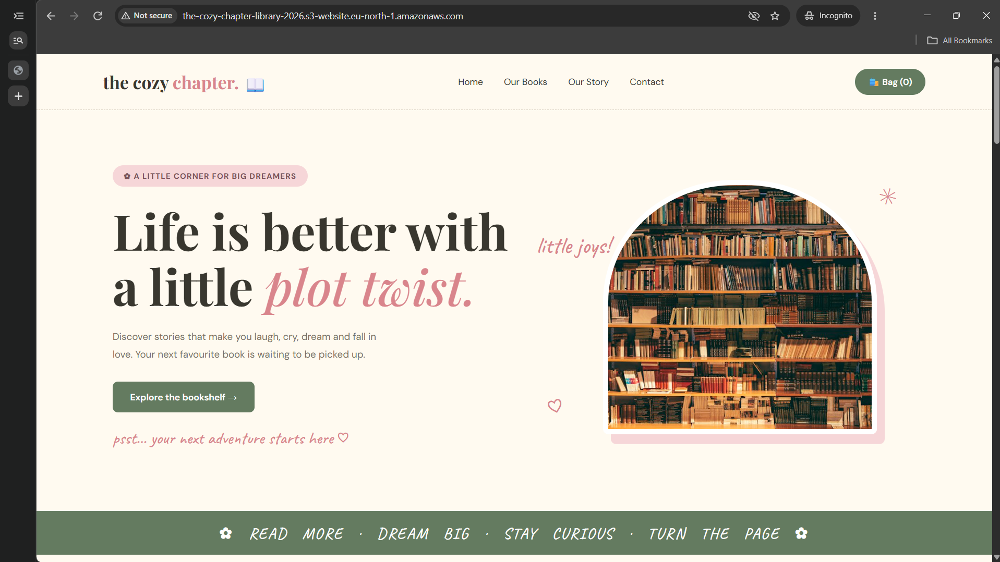
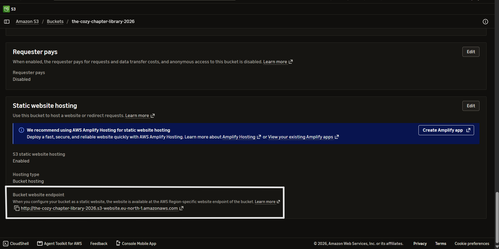

# The Cozy Chapter – AWS S3 Static Website

A cozy online bookstore website hosted on **Amazon S3 Static Website Hosting**.

The Cozy Chapter provides a book browsing experience with a catalogue of books, genre filters, search functionality and author information.

## Live Website

[Visit The Cozy Chapter](http://the-cozy-chapter-library-2026.s3-website.eu-north-1.amazonaws.com/)

## Project Screenshots

### Homepage


### Website Functionality


### S3 Bucket Objects


### Static Website Hosting Configuration



## Architecture

```text
Website Source Files
        |
        v
Amazon S3 Bucket
        |
        v
S3 Static Website Hosting
        |
        v
S3 Website Endpoint
        |
        v
Website Visitors
```

## Technologies Used

- **Amazon S3** – Static website hosting and file storage
- **HTML5** – Website structure
- **CSS3** – Styling and responsive layout
- **JavaScript** – Search, filtering and dynamic content
- **JSON** – Book, author and genre data
- **Git & GitHub** – Version control and project documentation

## AWS Implementation

1. Created an Amazon S3 bucket.
2. Configured the bucket for static website hosting.
3. Enabled the required public access configuration for website access.
4. Uploaded the website files and folders to the bucket.
5. Configured the website's index document.
6. Accessed and tested the deployed website using the S3 website endpoint.
7. Updated website files and verified the deployment.

## What I Learned

Through this project, I gained practical experience with:

- Understanding Amazon S3 buckets and objects.
- Creating and configuring an S3 bucket.
- Understanding static website hosting.
- Enabling website access through the appropriate bucket permissions.
- Uploading and organizing website files in S3.
- Understanding how an S3 website endpoint works.
- Deploying and updating a static website.
- Troubleshooting missing files and incorrect file paths.
- Using Git and GitHub to maintain project versions.

## Challenges and Troubleshooting

### Missing JSON Files

During deployment, the website initially failed to load its book catalogue because the JSON data files were not available at the expected S3 paths.

**Solution:** Verified the S3 folder structure and uploaded the JSON files into the correct `data/` directory.

### Local Fetch API Restrictions

Opening the website directly through the `file://` protocol caused browser CORS restrictions when JavaScript attempted to fetch JSON files.

**Solution:** Used Python's local HTTP server to test the website locally.

## Future Improvements

- Integrate Amazon CloudFront for content delivery.
- Configure HTTPS with a custom domain.
- Explore automated deployment using GitHub Actions.
- Explore AWS monitoring and cost management.

## Project Status

**Completed:** S3 static website deployment and GitHub documentation.
