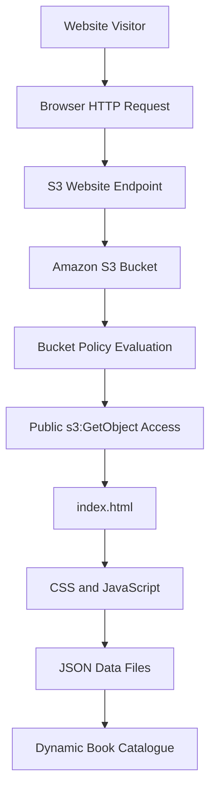
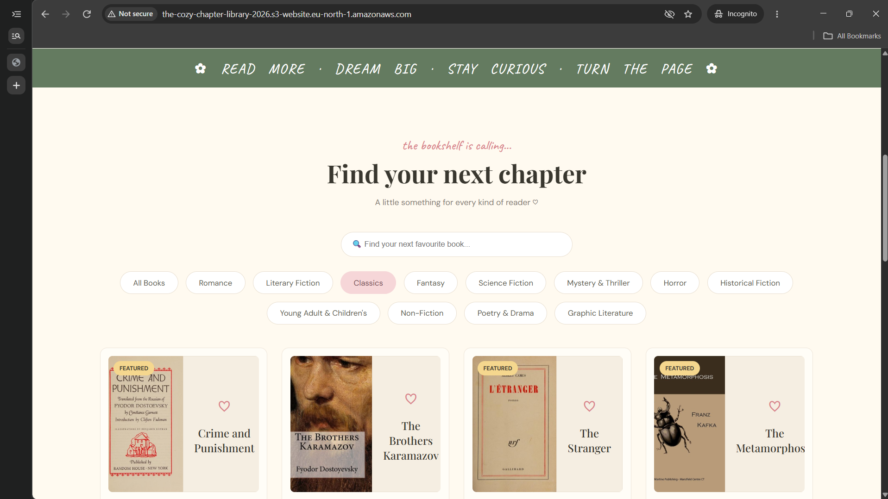
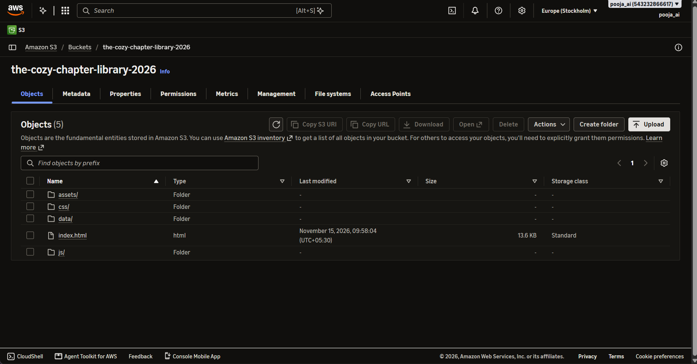

# The Cozy Chapter – AWS S3 Static Website Hosting


A hands-on AWS cloud computing project demonstrating how to deploy and host a dynamic, responsive online bookstore using **Amazon S3 Static Website Hosting**.

The Cozy Chapter is a bookstore website featuring a book catalogue, author information, genre filtering, search functionality, and dynamically loaded JSON data.

This project demonstrates practical cloud concepts including object storage, S3 bucket configuration, static website hosting, resource-based access policies, public read permissions, and website deployment.

---

##  Live Website

**Deployment Platform:**      Amazon S3 Static Website Hosting

**AWS Region:**               Europe (Stockholm) – `eu-north-1`

**S3 Bucket:**                `the-cozy-chapter-library-2026`

**Website Endpoint:**         `http://the-cozy-chapter-library-2026.s3-website.eu-north-1.amazonaws.com/`

Note: The S3 website endpoint uses HTTP. HTTPS is not configured directly on the S3 website endpoint.

---

##  Project Overview

The objective of this project was to build and deploy an online bookstore using Amazon S3 as the hosting platform.

Instead of provisioning and managing a traditional web server, Amazon S3 stores and serves the static website files through its website endpoint.

The website uses HTML, CSS, and JavaScript for the frontend, with JSON files containing book, author, and genre information.

JavaScript Fetch API requests retrieve the JSON data and dynamically display the catalogue.

##  Project Objectives

- Understand Amazon S3 and object storage.
- Create and configure an S3 general-purpose bucket.
- Understand AWS Regions and bucket configuration.
- Upload and organize website files as S3 objects.
- Enable S3 Static Website Hosting.
- Configure public read access using an S3 bucket policy.
- Understand resource-based policies and Amazon Resource Names (ARNs).
- Deploy and test a dynamic static website.
- Troubleshoot missing objects and frontend data-loading issues.

---

##  Technologies Used

| Technology | Purpose |
|---|---|
| Amazon S3 | Object storage and static website hosting |
| S3 Bucket Policy | Public read access and resource permissions |
| HTML5 | Website structure |
| CSS3 | Styling and responsive layout |
| JavaScript | Search, filtering, and dynamic content |
| JSON | Book, author, and genre data |
| AWS Management Console | AWS resource configuration |
| Git | Version control |
| GitHub | Source code and documentation |

---

##  AWS Architecture

The website is hosted directly through Amazon S3 without a separate application server.



### Request Flow

1. A visitor opens the S3 website endpoint.
2. Amazon S3 serves the configured index document.
3. The browser loads the HTML, CSS, and JavaScript files.
4. JavaScript requests the JSON catalogue data.
5. S3 evaluates the request permissions.
6. The permitted objects are returned to the browser.
7. The website displays the book catalogue and other content.

---

## ⚙️ AWS Implementation

### 1. Create an Amazon S3 Bucket

Created a general-purpose S3 bucket using the AWS Management Console.

**Configuration:**

| Setting | Value |
|---|---|
| Bucket Name | `the-cozy-chapter-library-2026` |
| AWS Region | `eu-north-1` |
| Region Name | Europe (Stockholm) |
| Bucket Type | General Purpose |
| Hosting Purpose | Static Website |

Public access configuration was adjusted to support the intended public website hosting setup.

### 2. Develop the Website

Built The Cozy Chapter using HTML, CSS, and JavaScript.

Website functionality includes:

- Book catalogue with book covers and descriptions.
- Author information.
- Genre-based filtering.
- Search functionality.
- Dynamically loaded catalogue data.
- Shopping cart interface.

JSON files were used to separate catalogue data from frontend logic.

### 3. Upload Website Files to Amazon S3

Uploaded the website files into the S3 bucket while maintaining their directory structure.

**S3 Bucket Structure:**

```text
the-cozy-chapter-library-2026/
│
├── index.html
│
├── css/
│   └── style.css
│
├── js/
│   ├── books.js
│   └── main.js
│
├── data/
│   ├── books.json
│   ├── authors.json
│   └── genres.json
│
└── assets/
    └── icons/
```

Maintaining the correct object paths is important because the website references CSS, JavaScript, images, and JSON files using relative paths.

### 4. Enable Static Website Hosting

Navigated to:

**Amazon S3 → Bucket → Properties → Static Website Hosting**

Configured the following:

| Setting | Configuration |
|---|---|
| Static Website Hosting | Enabled |
| Hosting Type | Host a static website |
| Index Document | `index.html` |
| Error Document | Not configured |

After saving the configuration, Amazon S3 provided the website endpoint.

### 5. Configure the S3 Bucket Policy

An S3 bucket policy was used to grant public read access to website objects.

This allows website visitors to retrieve the HTML, CSS, JavaScript, images, and JSON files without AWS authentication.

#### Bucket Policy JSON

```json
{
  "Version": "2012-10-17",
  "Statement": [
    {
      "Sid": "PublicReadForWebsite",
      "Effect": "Allow",
      "Principal": "*",
      "Action": "s3:GetObject",
      "Resource": "arn:aws:s3:::the-cozy-chapter-library-2026/*"
    }
  ]
}
```

#### Bucket Policy Explanation

| Policy Element | Description |
|---|---|
| `Version` | Specifies the IAM policy language version. |
| `Statement` | Contains the permissions granted by the policy. |
| `Sid` | Provides an identifier for the policy statement. |
| `Effect: Allow` | Allows the specified operation. |
| `Principal: "*"` | Applies to all requesters, including anonymous visitors. |
| `Action: s3:GetObject` | Allows objects to be retrieved from the bucket. |
| `Resource` | Specifies all objects inside the target S3 bucket. |

#### Understanding the Resource ARN

```text
arn:aws:s3:::the-cozy-chapter-library-2026/*
```

- `arn`: Amazon Resource Name.
- `aws`: AWS partition.
- `s3`: AWS service.
- `the-cozy-chapter-library-2026`: Bucket name.
- `/*`: Applies the policy to all objects inside the bucket.

#### Why Use `s3:GetObject`?

The `s3:GetObject` permission allows visitors to retrieve website files.

The policy does not grant public permissions to upload, modify, or delete objects.

**Important:** The bucket's Block Public Access configuration must allow the intended public bucket policy. Public access should be limited to a dedicated bucket containing only files intended for public viewing.

### 6. Test Website Accessibility

Opened the generated S3 website endpoint and verified that the deployed website loaded successfully.

Tested the website functionality, including:

- Homepage rendering.
- Book catalogue loading.
- Book cover display.
- Genre filtering.
- Search functionality.
- Author information.
- JSON data retrieval.

---

## Project Screenshots

The following screenshots demonstrate the deployment and website functionality.

### 1. Live Website


### 2. Website Catalogue and Functionality



### 3. S3 Bucket and Uploaded Objects



### 4. Static Website Hosting Configuration


---

## Challenges and Troubleshooting

### 1. Missing JSON Files in S3

**Problem:** The deployed website initially failed to load its book catalogue because the required JSON files were not present at their expected S3 object paths.

**Solution:** Verified the S3 bucket structure and uploaded the following files into the `data/` directory:

- `books.json`
- `authors.json`
- `genres.json`

Retested the website after uploading the missing objects.

### 2. Browser Fetch API and CORS Restrictions

**Problem:** Opening the website directly through the local `file://` protocol caused browser restrictions when JavaScript attempted to retrieve JSON files.

**Solution:** Used Python's built-in HTTP server to serve the website locally.

```powershell
cd C:\Users\POOJA\Desktop\the-cozy-chapter

py -3.12 -m http.server 8000
```

Opened the local website:

```text
http://localhost:8000
```

This allowed the browser to retrieve the JSON files over HTTP during local testing.

### 3. Maintaining the Correct S3 Object Structure

**Problem:** The website depends on relative paths to load its CSS, JavaScript, and JSON files.

**Solution:** Preserved the directory structure when uploading files to the S3 bucket and verified the expected object paths.

---

## Key Learnings

Through this project, I gained practical experience with:

### Amazon S3
- Creating and configuring S3 buckets.
- Understanding object storage.
- Organizing objects using key prefixes.
- Uploading and updating website files.
- Configuring static website hosting.

### AWS Security and Access Management
- Understanding resource-based policies.
- Writing JSON-based S3 bucket policies.
- Understanding IAM policy elements.
- Working with Amazon Resource Names (ARNs).
- Configuring public read access using `s3:GetObject`.
- Understanding the security implications of public S3 buckets.

### Cloud Deployment
- Deploying a static website to AWS.
- Understanding S3 website endpoints.
- Testing publicly accessible website resources.
- Troubleshooting deployment and missing-object issues.

### Frontend and Data Integration
- Using JavaScript Fetch API.
- Loading JSON data dynamically.
- Maintaining relative file paths.
- Testing websites locally and in a cloud environment.

---

## Security Considerations

This project intentionally uses public read access for static website hosting.

- The bucket policy allows public object retrieval.
- Public write and delete permissions are not granted by the policy.
- Only files intended for public access should be stored in the bucket.
- AWS credentials and secret keys must never be uploaded to a public repository or bucket.
- Public access configuration should be reviewed carefully before deployment.
- The S3 static website endpoint uses HTTP rather than HTTPS.

For production hosting, Amazon CloudFront can be introduced to provide HTTPS delivery and additional security controls.

---

## Future Improvements

- Integrate Amazon CloudFront for content delivery and HTTPS.
- Configure a custom domain using Amazon Route 53.
- Add a custom error document.
- Automate website deployments using GitHub Actions.
- Explore AWS monitoring and cost management.

---

## Project Author

**Pooja V**

B.Tech – Artificial Intelligence and Data Science

GitHub: [16ajoop](https://github.com/16ajoop)

Project Repository: [AWS Cloud Learning Project](https://github.com/16ajoop/aws-cloud-learning-project)

---

**Project Status:** Completed – Amazon S3 Static Website Hosting and Deployment.


